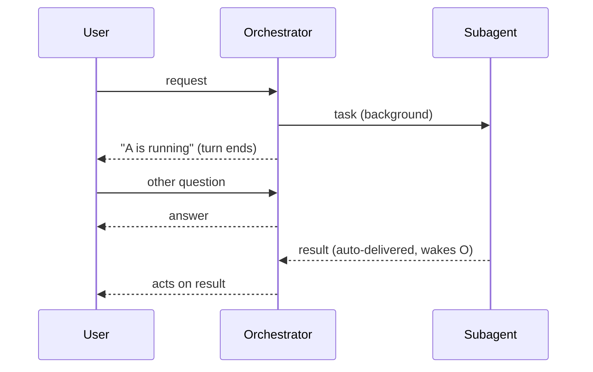

# omp-main-wait-guard

An [omp](https://github.com/can1357/oh-my-pi) extension that keeps your dialogue with the orchestrator free while subagents work. After spawning background agents, the main session ends its turn right away instead of parking in `wait`. When an agent finishes, its result arrives as a new message and wakes the orchestrator. There is nothing to interrupt and nothing to switch on.

## The problem

In omp, `task` already runs subagents as background jobs (`async.enabled`, default `true`): the tool call returns as soon as the agents are spawned. The dialogue gets stuck anyway because the orchestrator model calls `wait` right after spawning, and the harness prompts encourage that ("Completely blocked? Call `wait`"). `wait` holds the turn open for up to 30 minutes (`WAIT_MAX_MS`). Pressing Enter interrupts it, but the model usually answers and goes straight back into `wait`.

One real session logged 51 `wait` calls in total: 232 minutes, median 135 s, longest 1800 s.

## How it works

Two hooks, both active **only in the operator's session**: a top-level agent (`ctx.agent.kind === "main"`) with a UI (`ctx.hasUI`).

| Hook | Effect |
| --- | --- |
| `before_agent_start` | Appends a short `<main-wait-guard>` block to the system prompt: after spawning, tell the user what is running, end the turn, never call `wait`, never poll. It is appended once, guarded by a marker. |
| `tool_call` | If the model calls `wait` anyway, the call is blocked with a reason telling it to end its turn. Each block is logged through `pi.logger` (`~/.omp/logs/`). |

Subagents (`kind: "sub"`, including `/tan` clones) and headless runs (`omp -p`, RPC) are left alone and keep `wait` for their own children.

Ending the turn is safe because omp already handles it:

- With jobs in flight, the session settles as `awaitingAsyncWork` instead of stopping (`session/agent-session.ts`, `#hasPendingAsyncWake`).
- The todo stop-reminder skips itself while async jobs run (`session/todo-tracker.ts`, `checkCompletion`).
- Each finished job goes through the yield queue. If the session is idle, it starts a new turn (`injectIdle` → `agent.prompt`). If you are mid-conversation, it is injected at the next step boundary.



## Install

Requires omp **18.3.2 or newer** (`ctx.agent` was added there). Tested on 18.12.3.

```sh
git clone https://github.com/ivanvan08/omp-main-wait-guard ~/Work/omp-main-wait-guard
```

Add the checkout to `~/.omp/agent/config.yml`:

```yaml
extensions:
  - /home/<you>/Work/omp-main-wait-guard
```

omp reads `omp.extensions` from `package.json`. No build step and no `bun install` are needed at runtime, because omp supplies `@oh-my-pi/*` itself. The extension takes effect in **new** omp sessions. Sessions that are already running keep their old behaviour.

Register it through exactly one path. A copy in `~/.omp/agent/extensions/` or another plugin next to this entry would load the module twice.

To turn it off, remove the entry from `extensions:` or add it to `disabledExtensions`.

## Verify

```sh
bun install          # dev only: types + test runner
bun test             # handler behaviour: operator vs subagent vs headless
bun run typecheck
```

Live check: start `omp` and ask it to spawn one `sonic` subagent that runs `sleep 30` and then to call `wait`. The reply should end the turn right after the spawn, and you can keep typing. About 30 s later a "Background job completed" message appears and the orchestrator answers on its own. If the model still tries `wait`, `~/.omp/logs/` gets a `main-wait-guard: blocked wait in main session` line.

## Limits

- The model can still poll through other tools (`bash sleep`, repeated `read proc://…`). The prompt block forbids this, but the hook does not enforce it.
- If you explicitly ask the orchestrator to wait, it can't. It ends the turn and resumes when the result arrives, which has the same outcome.
